  

  <a href="https://github.com/rraj78502"><b>main profile</b></a> ·
  <a href="https://rraj78502.github.io"><b>portfolio</b></a> ·
  <a href="mailto:rraj78502@gmail.com"><b>email</b></a>

This is my **workshop account**: the place where products get built end to end. My main profile, teaching and Nepal Telecom work live at **[rraj78502](https://github.com/rraj78502)**.

Most repositories here are private client or internal work. The table below says what each one is without opening the code.

### On the bench

| Build | What it does | Stack |
|---|---|---|
| **GtradeA** | Cross-border commerce for Nepal: 1688/Alibaba sourcing, a pricing engine with HS codes, fees and FX, eSewa checkout, an offline-ready PWA | React · Supabase · Edge Functions |
| **GtradeA mobile** | The same storefront rebuilt natively, with Nepali wallets (eSewa, Khalti, connectIPS, Fonepay) | Flutter · Riverpod · go_router |
| **UTS** | Complaint and fault ticketing for Nepal Telecom, from first report to field crew | Go · Kafka · Centrifugo · Vault |
| **MW link planner** | Microwave link database for NTC: site IDs, monitoring, IP/VLAN planning, work orders, link budgets with terrain line-of-sight | TypeScript |
| **Site Plan Manager** | Site planning and tracking for Nepal Telecom | TypeScript |
| **Royal Fits** | Clothing and shoe store system: POS, inventory, storefront and a chatbot | TypeScript |
| **[Fashion AI storefront](https://github.com/rabi61743/clothing)** | Semantic search and outfit pairing on 768-dimension embeddings | Next.js · Go · pgvector |
| **Balen** | Nepal e-GP tenders, scraped into searchable bids and mapped down to municipality | Vite · Supabase · maps |
| **TutorConnect Nepal** | Matches home tutors and students by subject, distance, budget and schedule, with fair automated matching | React · Supabase · cron |
| **Samanhub** | B2B marketplace connecting Nepali suppliers, manufacturers and buyers | React · TypeScript |

### How I build

- **Data first.** Schema, row-level security and migrations come before the first screen.
- **Real payment rails.** Nepali wallets and gateways, not placeholder checkouts.
- **Ship to the phone.** Each web product gets a PWA or a native Flutter client.
- **Observable from day one.** Logs, metrics and audit trails are part of the build, not an afterthought.

### Activity

  

  

  

